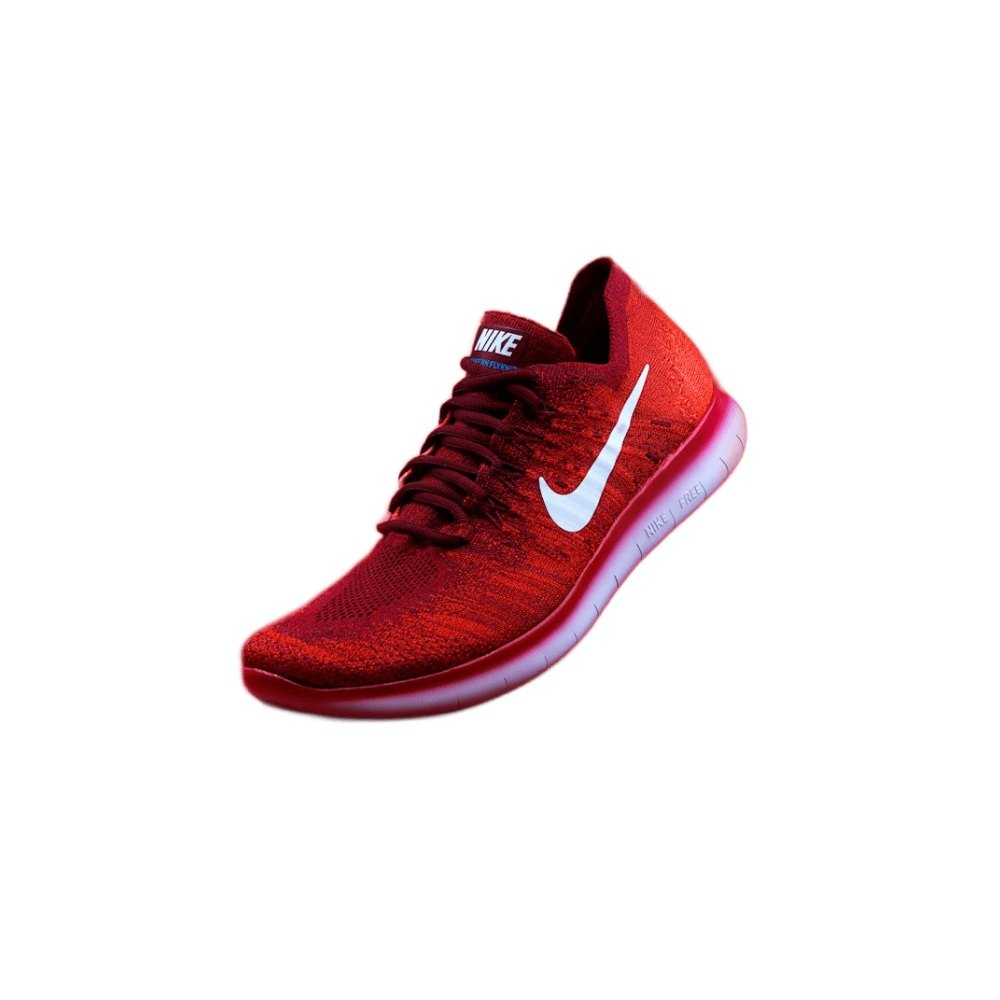
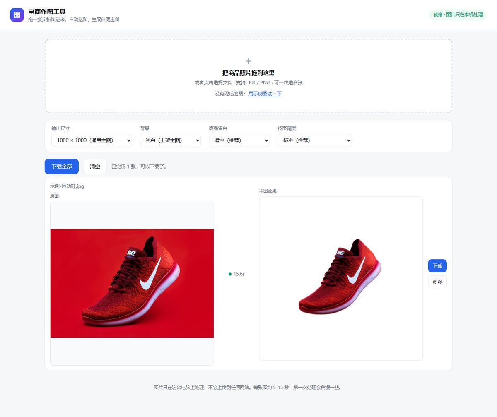

# 案例 01：37 分钟做一个本地电商作图工具

> 真实案例：一位**不懂代码**的用户，用本框架从一句话需求到一个可双击使用、可验收的 v1。
> 证据来源：项目 git 历史、DSH 会话日志（2026-11-03）、自动验收脚本输出、项目代码与 README。
> 项目位于用户本机（`F:\电商作图工具`），未公开发布；本文只引用过程与结果，不包含个人隐私。

---

## 一、背景与约束

用户原话（保留笔误）：

> 我不懂代码，只知道ai，我想做一个电商用的昨天工具

「昨天」应为「作图」，AI 根据工作目录名与上下文自行纠正，并在第一轮确认中复述。

| 约束 | 内容 |
|---|---|
| 用户能力 | 不懂代码，只会用 AI；判断标准只能是「能不能用」 |
| 平台 | Windows，双击启动，浏览器使用 |
| 网络 | 国内网络；不想一开始就花钱 |
| 隐私 | 商品照片不上传第三方 |
| 时间 | 单次会话内出第一版 |

## 二、需求对齐

开工时自动加载了 `ai-project-delivery`（全局 AGENTS 规则要求），并切换到**非技术用户模式**：一次最多 3 个问题、不展示代码、每次交付可演示。

提问共 3 轮，覆盖：

1. 做哪种图：商品主图 / 场景图 / 模特图 / 促销海报
2. 怎么用：网页工具 / 桌面软件 / 手机
3. 素材来源与 AI 账号：上传实拍图 vs 纯文字生成；有没有可用的国内 AI 账号

确认后，AI 用 5 句话复述需求，用户确认「对，就按这个做」。第一版最终确定为：**上传实拍商品图 → 本地抠图 → 生成纯白底 1000×1000 主图 → 可下载（单张/打包）**。

期间遇到一次环境问题：F 盘工作区沙箱 ACL 报错（`SetNamedSecurityInfoW failed (Win32 5)`），加载 `diagnose-windows-sandbox-acl` 修复后才开始写代码。这是一次真实的「先修环境，再写业务」。

## 三、范围决策：v1 故意不接 AI

为了让「AI 换场景」这个更诱人的功能不拖垮第一版，AI 启动了一个子代理，用 12 分钟核实国内三家图像 API 的现状（10 次搜索 + 22 次网页抓取）：

- 阿里云百炼 / 通义万相：编辑类模型价格、异步轮询、是否支持自有图
- 火山方舟 / 豆包 即梦：Seedream / SeedEdit 的 endpoint 与价格
- 腾讯混元：商品背景生成的价格与免费额度

结论：**v1 先不接**——账号、单张成本与保真度都还没确认，先用本地抠图把「白底主图」这个刚需做扎实。这个决策写进了 README 的「这一版故意没做的事」。

| 做 | 不做（留到下一版） | 理由 |
|---|---|---|
| 本地抠图、白底/纯色/透明底、尺寸与留白、批量下载 | AI 换场景 / 换背景 | 需要账号与费用，保真度未验证 |
| 图片只在本机处理 | 模特上身图、促销海报、详情页长图 | 需求未确认，先做最刚需的 |
| 双击启动 + 浏览器界面 | 对接淘宝/京东后台 | 复杂度高，价值待验证 |

## 四、实现与验收

**技术栈**：Node 24 + 原生 http 服务 + `@imgly/background-removal-node`（模型随依赖打包，126 MB，离线运行）+ 前端 Canvas 合成。代码中没有任何外部 URL。

**自动验收脚本**（`scripts/ui-check.mjs`）：用无头 Edge + CDP 打开页面 → 自动跑示例图 → 等待出图 → 点击下载并确认文件落盘 → 切换透明底确认重绘 → 截图。

本仓库作者复跑该脚本的真实输出：

```
处理结果: {"done":1,"err":0,"hint":"已完成 1 张，可以下载了。","engine":"就绪 · 图片只在本机处理"}
已下载成品: 示例-运动鞋-主图-1000x1000.jpg (73 KB)
切换透明底: 透明格子=true 图片已重绘=true 颜色框隐藏=true
PASS 证据目录: <临时目录>
```

耗时 36.5 秒，包含启动服务与无头浏览器。

**交付时给用户的 3 条人工验收**（原文）：

1. 双击 `启动工具.bat`，浏览器自动打开页面，右上角显示绿色的「就绪 · 图片只在本机处理」。
2. 点「用示例图试一下」，10～20 秒后右边出现白底鞋图；点「下载」，文件能正常打开、尺寸是 1000×1000。
3. 拖 1～2 张**你自己的**产品照片进去，看商品主体有没有抠干净。

**证据**：

| 图 | 说明 |
|---|---|
|  | 自动验收产出的 1000×1000 白底主图（未手工修图） |
|  | 工具界面与处理结果 |
|  | 切换透明底后的界面 |

> 示例图（运动鞋）为项目自带的演示素材，仅用于展示功能。

## 五、一次真实返工

首个提交之后、交付之前，发现启动脚本有编码问题、示例图入口不清晰、验收脚本需要调整，于是产生第二个提交：

```
f7f757d 修复启动脚本编码、示例图入口、验收脚本   (3 个文件，+25/-21)
5514adb 第一版：本地抠图 + 白底主图生成          (15 个文件，+2001)
```

这类问题不在业务逻辑，而在「用户第一次打开」的体验层——正是非技术用户模式要求「可演示、可自己点」才能暴露出来的。

## 六、结果

| 指标 | 数值 |
|---|---|
| 从开工到交付 | 22:23:19 → 23:00:36，**约 37 分钟**（含 12 分钟子代理调研与一次 ACL 修复） |
| 提交 | 2 次 |
| 代码规模 | 26 个文件、1.2 MB（不含依赖）；依赖 290 MB（其中抠图模型 126 MB） |
| 使用成本 | 0 元（本地处理，不调用付费 API） |
| 交付物 | 双击启动脚本、浏览器界面、示例图、批量下载、透明底、使用说明与常见问题 |

## 七、框架对照：哪些阶段真的走了

| 阶段 | 是否执行 | 证据与说明 |
|---|---|---|
| 1 对齐 | ✅ | 3 轮提问 + 5 句话复述确认 |
| 2 原型/研究 | ✅ | 子代理调研国内 API，支撑「暂不接 AI」决策 |
| 3 规格 | ⚠️ 轻量 | 没有单独 spec 文档；用 5 句确认 + README 范围说明代替。单会话项目，框架允许跳过正式规格 |
| 4 工单 | ⚠️ 跳过 | 用 5 条 todo 代替，未拆 DAG（单会话、单人，拆了反而增加成本） |
| 5 实现 | ✅ | 11 次写文件、11 次编辑、48 次命令 |
| 6 评审 | ⚠️ 替代 | 没有独立 reviewer；用自动验收脚本 + 8 次查看截图替代 |
| 7 交付 | ✅ | 自动验收 PASS + 3 条用户人工验收 |
| 8 复盘 | ❌ 当时没做 | 本文即补做的复盘 |

## 八、诚实边界（这个案例不能宣称什么）

1. **没有对照组**：不能声称「用了框架效率提升 X%」。能说的是「37 分钟交付了一个可验收的 v1」。
2. **验收不是 test-first**：自动验收脚本在功能完成后补写，不是先写失败测试。
3. **质量没有量化标准**：抠图好坏靠人工目测；白鞋、玻璃杯、镂空、毛边等困难样本没有基准集。
4. **不能外推**：这是单会话小项目；跨会话、多人协作、复杂业务另当别论。
5. **示例图版权**：演示用的运动鞋图来自项目自带素材，仅作功能展示。

## 九、下次会改什么

1. **验收前置**：开工时就把 3 条验收写成 checklist，而不是交付前才整理。
2. **建立难图基准**：挑 5 张困难样本（白鞋、玻璃、镂空、毛边、强反光），每次改动跑一遍，把「感觉还行」变成「5 张里 4 张通过」。
3. **记录成本与耗时**：本次靠日志时间戳回填；下次在项目里留一个 `NOTES.md` 记关键时间点。
4. **v2 接 AI 换场景前**：先确认账号、单张成本上限与保真度验收标准，再写代码。

## 附录：如何复现

项目在本机，命令如下（需要 Node 24）：

```powershell
cd F:\电商作图工具
node server.mjs                                   # 启动，默认 http://127.0.0.1:3210
node scripts/ui-check.mjs                         # 自动验收，截图落在 samples/ui-check/
git log --oneline                                 # 两次提交
```

自动验收判断标准：处理完成、下载文件真实落盘、透明底切换后重绘且颜色选择框隐藏。
