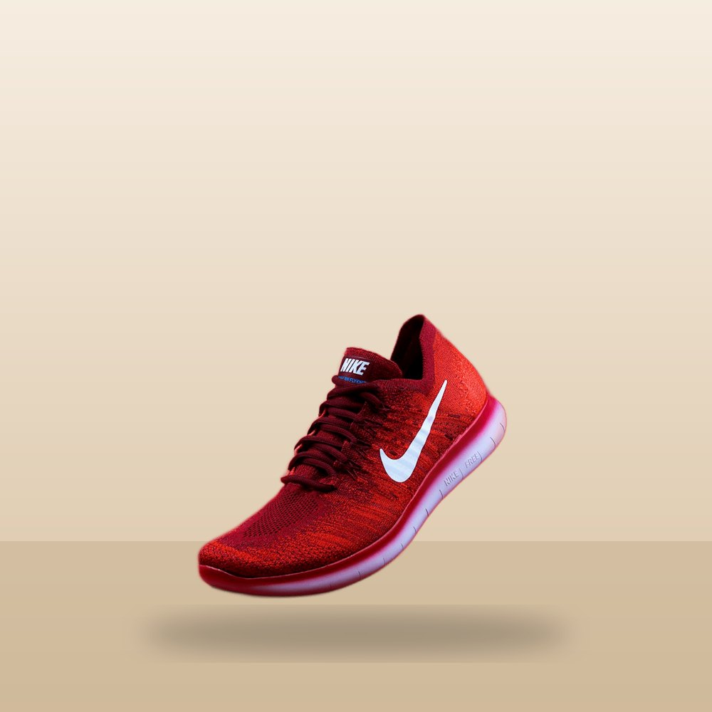
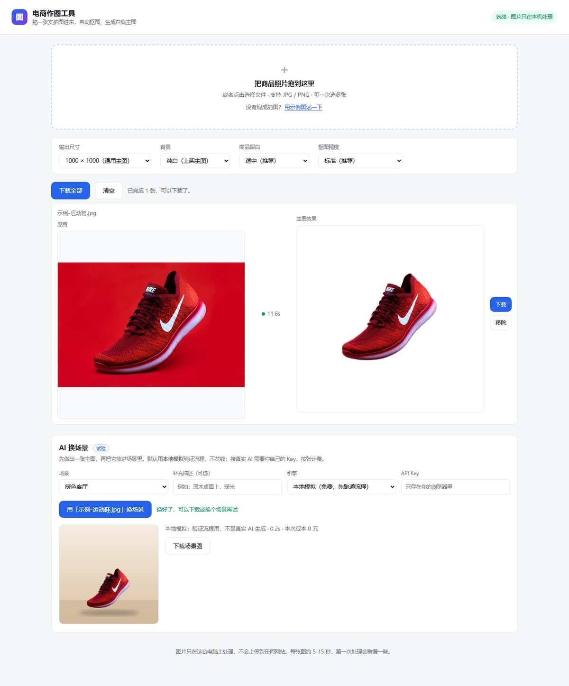

# 案例 02：给已上线的小工具加「AI 换场景」（mock 优先，真实 API 待验证）

> 同一项目（`F:\电商作图工具`）的 v2 与 v2.1。案例 01 的 v1 故意不接 AI；这一篇记录**当外部依赖无法验证时**怎么推进，以及「生成模型 + 理解模型」的分工。
> 证据来源：项目 git 历史（commit `f42a07a`、`790263b`）、自动验收输出、接口守卫测试、代码与 README。

---

## 一、背景

v1（案例 01）只做白底主图：本地抠图 + Canvas 合成，零成本、离线、可验收。v2 的目标是把主图放进场景（客厅 / 户外 / 影棚 / 纯色）。

约束没有变：用户不懂代码；手上没有可用的 AI Key；不能为了「跑通流程」先充值；也不允许把没验证过的真实接口写成「已完成」。

## 二、决策：先把无法验证的部分隔离

案例 01 的子代理调研（2026-11-03，官方文档）给出了三家现状：

| 服务 | 适配度 | 参考价 | 关键成本 |
|---|---|---|---|
| 腾讯混元 `ReplaceBackground` | ★★★ 商品专用换背景、自动抠图、文档明确「保留商品主体」 | 0.12 元/张（免费 50 次） | 需要 TC3-HMAC-SHA256 签名 |
| 火山方舟 Seedream 5.0 flash | ★★ 通用参考图生成，靠提示词保真 | 0.12 元/张 | Bearer Key + JSON，接入最简单 |
| 阿里百炼 wanx2.1-imageedit | ★★ Legacy，异步任务轮询 | 0.14 元/张，无免费额度 | 需自备 mask |

**选择**：先实现「本地模拟引擎 + 火山方舟适配器」。

- 本地模拟：把「场景选择 → 生成 → 预览 → 下载」这条**可验证的流程**做完整，不花钱、不联网。
- 火山方舟：按官方文档写适配器（Bearer Key、`/api/v3/images/generations`、`b64_json`），但**在拿到 Key 之前不宣称能用**。
- 腾讯方案更贴合商品保真，但签名复杂度高，留作候选，不在这一版实现。

这条决策对应框架里的一个核心原则：**把不可验证的外部依赖隔离在适配器后面，验收只覆盖能验证的部分，并明确标注未验证的部分。**

## 三、实现（commit `f42a07a`）

| 层 | 内容 |
|---|---|
| 服务端 | 新增 `POST /api/scene`、`GET /api/scene-info`；mock 用 `sharp` 生成渐变背景 + 地面 + 阴影，再合成抠图；volcano 适配器按官方文档调用 |
| 前端 | 主图完成后出现「AI 换场景」面板：场景 / 补充描述 / 引擎 / API Key；结果预览与下载 |
| 安全 | Key 只存在浏览器 `localStorage`；未填 Key 时选真实引擎会得到 400 提示，不会静默失败 |
| 成本 | 界面显示「本次成本 0 元」或「估算约 0.12 元/张」；真实计费以服务商账单为准 |
| 验收 | 新增 `scripts/scene-check.mjs`（无头 Edge）：主图完成 → 按钮可用 → 场景结果出现 → meta 含「本地模拟」→ 下载新文件 >10KB |
| 回归 | 重跑 v1 的 `scripts/ui-check.mjs`，确认白底主图流程没被改坏 |





## 四、验证结果

**换场景验收（本地模拟）**：

```
主图状态: {"done":1,"err":0,"btnDisabled":false,"hint":"主图已就绪，可以换场景了"}
场景结果: {"visible":true,"srcOk":true,"meta":"本地模拟：验证流程用，不是真实 AI 生成 · 0.2s · 本次成本 0 元"}
已下载场景图: 示例-运动鞋-场景图.png (284 KB)
PASS
```

**v1 回归**：

```
处理结果: {"done":1,"err":0,"hint":"已完成 1 张，可以下载了。","engine":"就绪 · 图片只在本机处理"}
已下载成品: 示例-运动鞋-主图-1000x1000.jpg (73 KB)
切换透明底: 透明格子=true 图片已重绘=true 颜色框隐藏=true
PASS
```

**接口守卫**：`provider=volcano` 且没有 Key 时返回 `400`，提示先在页面填写或设置 `ARK_API_KEY`，不会发出真实请求。

## 五、框架对照

| 原则 | 这次怎么落地 |
|---|---|
| 验证带宽定律 | 只承诺可验证的部分：UI、流程、下载、错误处理；真实 AI 输出不在验收范围 |
| 外部依赖隔离 | `mock` 与 `volcano` 同一接口，前端不感知；用 mock 做离线回归 |
| 成本边界 | 无 Key 不发请求；界面标注估算成本；README 写明参考价与「以账单为准」 |
| 诚实边界 | README、案例、UI 文案三处都写明「真实 API 未验证」 |
| 回归 | v1 的验收脚本重跑通过，确认 v2 没有破坏原有能力 |
| 没做的 | 没有独立 review；没有真实 Key 的端到端测试；没有保真度基准 |

## 六、诚实边界（这一版不能宣称什么）

1. **真实 API 一次都没有调用过**：模型名、参数、返回格式都按官方文档写，可能随版本变化失效。
2. **mock 不是 AI**：它只证明流程通，不能当效果参考；截图里的合成图是程序画的背景。
3. **价格只是估算**：0.12 元/张来自 2026-11 的公开价格页，实际以账单为准；未做费用实测。
4. **没有保真度数据**：没有拿 5 张难图（白鞋、玻璃、镂空、毛边、反光）做前后对比。
5. **腾讯方案更合适但没实现**：商品专用接口的保真承诺更强，代价是签名复杂度；当前选择是复杂度优先，不是效果优先。

## 七、下次会改什么

1. **拿到 Key 后只跑 1 张**：记录真实耗时、费用、主体是否变形；通过再批量。
2. **若保真度不够，切腾讯 `ReplaceBackground`**：实现 TC3 签名，复用同一 `provider` 接口。
3. **建立 5 张难图基准**：给 mock 与真实引擎各跑一遍，定义「可接受」的量化标准。
4. **保留 mock 作为离线回归**：CI/本地验证不依赖外部服务，也不产生费用。

## 九、v2.1：把 DeepSeek 放到正确的角色（提示词 + 视觉质检）

有人会问：能不能干脆用 DeepSeek 换场景？**不能。** 核对官方文档（2026-11）：DeepSeek API 只有 `deepseek-flash` / `deepseek-v4-pro` 两个对话模型，`deepseek-flash` 支持**图片输入**，但输出是文字，没有图像生成或编辑接口。

不过 DeepSeek 能补上两个真实缺口：

| 位置 | 做什么 | 价值 |
|---|---|---|
| 提示词 | 把「原木桌面暖光」改写成可执行的场景描述 | 图像模型更容易理解，减少来回试 |
| 视觉质检 | 对比原图与场景图，检查变形/裁切/背景/穿帮 | 补上「生成后没人验收」的缺口 |

实现：

- 新增 `POST /api/refine-prompt`、`POST /api/vision-check`
- DeepSeek Key 只存在浏览器本地；不填时返回 400 并说明怎么配置
- 质检前把两张图缩到 1024 以内再发送，控制体积与 token 成本
- 服务端支持 `MOCK_AI=1`：两个接口返回确定性的模拟结果，便于离线验收

**验收证据（MOCK_AI=1，不调用真实模型）**：

```
优化描述: {"value":"放在温暖的客厅木桌上，柔和自然光，浅景深（默认构图）","hint":"已用模拟模式生成描述（未调用真实模型）"}
DeepSeek 质检: {"text":"通过：模拟检查通过（未调用真实模型）\n（模拟模式：未调用真实模型）"}
scene-check: PASS
ui-check（v1 回归）: PASS
```

**接口守卫**（无 Key 时，Node fetch 实测）：

```
refine 400 {"ok":false,"error":"需要先在页面里填 DeepSeek API Key，或启动前设置环境变量 DEEPSEEK_API_KEY"}
vision 400 {"ok":false,"error":"需要先在页面里填 DeepSeek API Key，或启动前设置环境变量 DEEPSEEK_API_KEY"}
```

**这一节的诚实边界**：

1. 真实 DeepSeek 调用没有验证（没有 Key）；模型名、vision 消息格式按官方文档写。
2. 质检是「辅助判断」，不能替代人工；它可能漏掉细节。
3. 用质检会把两张图发送到 DeepSeek，使用前需确认隐私要求。
4. 成本按 token 计，通常单次几分钱以内，但未实测。

**框架启示**：生成模型和评审模型可以是两个不同能力——**用便宜的「理解模型」给贵的「生成模型」做验收**，比单纯加人工检查更有性价比。这同时是「冷上下文评审」在图片上的变体。

## 附录：复现

```powershell
cd F:\电商作图工具
node server.mjs                                  # 启动
node scripts/scene-check.mjs                     # 换场景验收（本地模拟）
node scripts/ui-check.mjs                        # v1 回归
git log --oneline                                # 3 次提交
```

真实引擎（未验证）：启动前设置 `ARK_API_KEY`，可选 `ARK_MODEL`（默认 `doubao-seedream-5-0-flash-260915`）。
